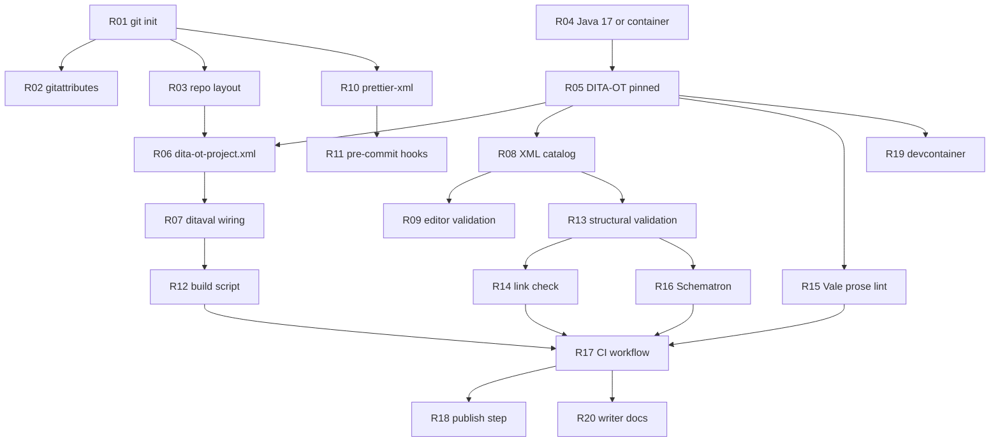

# Recipes

Each recipe is one idempotent setup step. Every recipe declares its dependencies, its capability
requirements, its degrade path, and how to prove it worked.

Resolve each recipe against `probe.json` capabilities into exactly one of:

- **EXECUTE** - dependencies satisfied, inside the autonomy envelope
- **DEGRADE** - a lesser free fallback exists; install it and record the upgrade path
- **DEFER** - a human must unlock it; skip the subtree cleanly and write a blocker card

**Degrade before you defer.** **A deferred branch is cleanly absent, never half-built.**

---

## Execution order



---

## R01 - Initialise version control

- **Needs:** nothing. **Capability:** `has_vcs_client`
- **Skip if:** `incumbent.vcs` is already set
- **Does:** `git init`, a DITA-aware `.gitignore` (excludes `out/`, `temp/`, `.gradle/`; for Flare
  also `Output/`, `Analyzer/`, `FileSync/`, `Project/Users/`)
- **Degrade:** if the team is on SVN or Perforce, do not migrate. Record an ADR and continue - the
  rest of the pipeline can still be built.
- **Prove:** `git status` reports a repository
- **Why first:** every other axis depends on it. A team at 0 here gets this before Schematron.

## R02 - `.gitattributes` for XML

- **Needs:** R01
- **Does:** normalise line endings for `*.dita*`, `*.xml`, `*.dtd`, `*.ent`, `*.mod`, `*.xsl`;
  mark binaries (`*.png`, `*.jpg`, `*.woff`) so Git stops trying to diff them
- **Prove:** `git check-attr text -- some.dita`
- **Modelled on:** the `.gitattributes` in `dita-ot/docs`, which is the most battle-tested public
  example

## R03 - Repository layout

- **Needs:** R01. **Skip if:** content is already organised and in use
- **Does:** for a greenfield repo only, create `src/maps`, `src/topics`, `src/shared` (conref
  warehouse and keydefs), `src/media`, `config/`
- **Never:** move existing content. Moving or renaming a DITA file breaks every reference to it,
  and doing that unattended is exactly the kind of action that gets a tool uninstalled.

## R04 - Establish a build runtime

- **Needs:** nothing. **Capability:** `can_build_native` or `can_build_container`
- **Does:** verify Java is in the 17 to 21 range
- **Degrade:** no usable Java but Docker and `ghcr.io` reachable, so use
  `ghcr.io/dita-ot/dita-ot:4.4.1`. **Lost:** Vale cannot lint `.dita` files, because Vale shells
  out to the `dita` command.
- **Defer:** neither available. This is `BLK-no-build-path`, and it is critical - nothing
  downstream can be verified.
- **Never:** run a bare `brew install dita-ot`. The formula depends on plain `openjdk`, which
  currently resolves far beyond what DITA-OT is tested against. Pin `temurin@17`.
- **Never:** use `ditaot/dita-ot` on Docker Hub. Abandoned, newest tag 2.5.3.

## R05 - Install and pin DITA-OT

- **Needs:** R04. **Capability:** `can_install_dita_ot` or `can_build_container`
- **Does:** install DITA-OT **4.4.1** and record the exact version in `.dac/config.yml`
- **Pin to the editor's bundled version where one exists.** Oxygen 28.1 bundles 4.4.0 and XMetaL
  20.0 bundles 4.2.2 XM. Matching CI to the editor is what stops "it works in Oxygen but not in
  CI". Note that XM is a modified build, so 4.2.2 stock is close but not identical.
- **Degrade:** container only
- **Prove:** `dita --version`

## R06 - `dita-ot-project.xml`

- **Needs:** R05, R03
- **Does:** declare each deliverable as a `<deliverable>` with its `<context>`, `<input>`,
  `<profile>`/`<ditaval>` and `<publication>` with `@transtype`
- **Why:** deliverables become declarative data an agent can read and modify, instead of build
  logic buried in a shell script. This is what makes the repo legible to the writer's AI IDE.
- **Validate against:** `resources/project.rnc` in the DITA-OT installation, using **jing** - not
  `xmllint`, which is not a dependable RELAX NG validator
- **Gotcha:** `<output href>` resolves relative to the CLI `--output` directory, not the project
  file
- **Adopt, don't impose:** if filters are already applied from a `build.gradle`, that is a valid
  configuration. Record an INFO note suggesting the move; do not rewrite their build.

## R07 - Wire every ditaval to a deliverable

- **Needs:** R06. **Severity if missing: high**
- **Does:** ensure every `.ditaval` in the repo is referenced by a deliverable profile
- **Why this is not optional:** a build that omits `--filter` emits conditional content into the
  wrong output and **still exits zero**. DITA-OT does not warn. Green and wrong is the most
  dangerous failure class in DITA publishing, and the one a writer is least equipped to notice.
- **Prove:** build two deliverables with different ditavals and confirm the outputs differ

## R08 - XML catalog

- **Needs:** R05
- **Does:** export `XML_CATALOG_FILES=$DITA_HOME/catalog-dita.xml` in the build script and CI
- **Why:** DITA files reference public identifiers such as `-//OASIS//DTD DITA Map//EN`. Without a
  catalog, validation either fails outright or silently fetches DTDs over HTTP - which is slow,
  non-reproducible, and fails entirely on an air-gapped runner.

## R09 - Editor-side validation for a free IDE

- **Needs:** R08
- **Does:** write `.vscode/settings.json` wiring the Red Hat XML extension (lemminx) to the DITA
  catalog:

```jsonc
{
  "xml.catalogs": ["${DITA_HOME}/catalog-dita.xml"],
  "xml.validation.enabled": true,
  "xml.validation.resolveExternalEntities": true,
  "xml.server.vmargs": "-Djdk.xml.entityExpansionLimit=128000"
}
```

- **Both non-default settings are required, not optional.** Without `resolveExternalEntities`,
  modular DITA DTDs silently fail to resolve. Without the `entityExpansionLimit` bump, modern DITA
  DTDs blow past the JDK's 64,000-entity default and IntelliSense breaks on the root element.
  Neither is discoverable.
- **Honesty requirement:** Red Hat XML has over ten million installs and is actively maintained;
  it is the credible free validation layer. DitaCraft is the only purpose-built DITA extension but
  has roughly 1,200 installs and shares a sole maintainer with the Gradle plugin. Offer it as
  optional and name the risk. **Do not promise a rich VS Code DITA authoring experience** - it
  does not exist. Writers should keep authoring in Oxygen, Arbortext or XMetaL.

## R10 - Deterministic XML formatting

- **Needs:** R01. **Capability:** `can_normalise_xml`
- **Does:** add `@prettier/plugin-xml` with `xmlWhitespaceSensitivity: strict`, and a `format`
  script covering `**/*.{dita,ditamap,ditaval,xml}`
- **Why this is the flagship recipe:** "XML diffs are unreadable in pull requests" is the single
  most common objection to DITA in a docs-as-code workflow, and it is already solved in practice.
  `dita-ot/docs` normalises every `.dita*` file this way. Deterministic formatting is what makes
  review possible.
- **Adopt, don't impose:** if `@prettier/plugin-xml` is already configured, change nothing.
- **Sequencing:** run the formatter as its own commit, before any other change, so the
  reformatting diff never mixes with content edits.
- **Degrade:** no Node or no npm registry, so skip and record `BLK-no-xml-formatter`, naming the
  review cost explicitly.

## R11 - Pre-commit hooks

- **Needs:** R10
- **Does:** husky plus lint-staged, running the formatter and a fast well-formedness check on
  staged files only
- **Adopt, don't impose:** if `.husky/` exists, add to the existing chain. A second hook system
  will fight the first, and the existing hook may reject DAC's own commits.
- **Keep hooks stateless and fast.** DITA For Small Teams died partly because it wired client-side
  Git hooks to a stateful BaseX XQuery database. Anything needing a server belongs in CI.

## R12 - One build script

- **Needs:** R07
- **Does:** `scripts/build.sh` that CI and the writer run **identically**, taking a deliverable
  name and calling `dita --project=... --deliverable=...`
- **Note:** `--deliverable` is repeatable only from DITA-OT 4.4 onward
- **Why identical:** "works on my machine" is unanswerable when the two paths differ

## R13 - Structural validation

- **Needs:** R08
- **Does:** `dita validate --input=<map>` per map, plus `xmllint --noout` with the catalog
- **Add `--processing-mode=strict`** so warnings that indicate real breakage fail the build
- **Degrade:** no Oxygen Scripting licence, so use DITA-OT validate plus xmllint. **Lost:**
  "Validate and Check For Completeness", the most thorough DITA link and completeness check
  available. Record the upgrade path with its price.
- **Use jing for RELAX NG**, not xmllint - relevant for DITA 2.0 draft grammars and `project.rnc`

## R14 - Link and reference integrity

- **Needs:** R13
- **Does:** a dedicated link check in addition to the build
- **Why separate:** **a green `dita` exit code is not sufficient evidence of reference
  integrity.** Unresolved conrefs in the PDF preprocess stage produced no message at all until a
  fix closed in July 2023, and keyrefs inside conref'd content went unresolved in 3.5 through
  3.6.1 against the spec's intent.
- **Watch for these codes:** `DOTJ041E` (bad `@conref` syntax), `DOTJ046E` (unresolvable
  `@conkeyref`), `DOTX010E` (missing `@conref` target), `DOTX028E` (link with no valid target)
- **AEM Guides needs a bespoke checker.** UUID-based referencing means a filename-based link check
  passes clean on genuinely broken links. This checker cannot share code with the other
  archetypes.

## R15 - Prose linting

- **Needs:** R05. **Capability:** `can_lint_prose_dita`
- **Does:** `.vale.ini` scoped to `[*.dita]` only
- **Three hard constraints:**
  - Vale needs DITA-OT on `PATH`, because it runs `dita` with the html5 transform and lints the
    result. No Java means no prose linting of `.dita`.
  - **`.ditamap` is not a supported extension.** Map-level prose goes unlinted. Do not report
    coverage you do not have.
  - **Never add a `[formats]` section mapping `dita`** - it silently breaks native DITA handling.
    A bare `[*.xml]` section without a `Transform` also emits "No XSLT transform provided!" for
    every stray XML file.
- **Version floor:** 3.22.0 for `TokenIgnores` and `BlockIgnores` on DITA. Below that, style
  exceptions cannot be suppressed.
- **Expect it to be slow.** Vale invokes `dita` per run and its own docs warn of worse performance
  on DITA. On a few hundred topics this can look hung - say so in the runbook.

## R16 - Schematron house rules

- **Needs:** R13
- **Does:** a starter `config/schematron/house-rules.sch` plus a CI step
- **CI, not the editor.** Schematron has effectively no editor presence - the lemminx Schematron
  bridge has a few hundred installs. Oxygen has first-class support if licensed.
- **Free CLI:** SchXslt (`java -jar schxslt-cli.jar -d doc.xml -s schema.sch -o report.xml`, with
  `-e` to set a nonzero exit code). Note that `xmllint --schematron` covers only a subset of ISO
  Schematron and is unreliable for abstract patterns and phases.
- **Egress note:** if Maven Central is denied, fetch the jar from the project's own release page or
  an internal proxy.

## R17 - CI workflow

- **Needs:** R12, R13, R14, R16, R15
- **Does:** validate on pull request, build and publish on merge
- **Adopt, don't impose - this is the recipe most likely to cause damage.** If CI already exists,
  extend it. Writing a second workflow gives the repo duplicate builds, and if the existing
  workflow includes a format check, DAC reformatting source makes it fail.
- **Pin the DITA-OT version as a workflow input** and cache it by version key, the way
  `dita-ot/docs` does
- **Container jobs must override the entrypoint** (`options: --entrypoint ""` on GitHub,
  `entrypoint: [""]` on GitLab), because the image entrypoint already runs `dita`
- **Watch the action's output path:** `dita-ot-action` writes to
  `${output-path}/${transtype}`, not `${output-path}`. Its README is stale in several
  places - it claims a `dita-ot-version` default that `action.yml` does not declare, and its
  examples use long-superseded actions.
- **Flare runners must be pinned Windows**, and an antivirus exclusion is needed for the `Output`
  folder

## R18 - Publish and deliver

- **Needs:** R17
- **Does:** wire the deploy target
- **Fluid Topics:** `POST /api/admin/khub/sources/{id}/upload`, Bearer key, and the **mandatory
  `Ft-Calling-App` header**. Ask for `CONTENT_PUBLISHER`, not `KHUB_ADMIN`. A 404 here usually
  means a permissions problem, not a wrong URL.
- **Archetype E:** call the render service instead of building locally, and account for queueing.
  FMPS allows only one queued task at a time.
- **Never** wire a publish step to Zoomin. Raise a migration-risk finding instead.
- **Check where output actually goes.** `dita-ot/docs` pushes rendered output into a *different
  repository* with a PAT. A GitHub Pages assumption would conflict with the real deployment.

## R19 - Devcontainer

- **Needs:** R05
- **Does:** `.devcontainer/devcontainer.json` pinning JDK 17, Node 20+, DITA-OT 4.4.1, Vale, and
  the Red Hat XML extension
- **Why:** "install Java, install the toolkit, set the path" is the single biggest onboarding
  failure in DITA-as-code. A devcontainer makes the laptop and CI the same image.

## R20 - Writer documentation

- **Needs:** R17. See `WRITER-DOCS.md`.

---

## Interaction surfaces

A pipeline the writer cannot query is a pipeline they will not trust. These three recipes give
them a way to *work with* their DITA as code, rather than only having it built for them. All
three are thin wrappers over one shared engine, so they cannot drift apart.

## R21 - The `docs` command

- **Needs:** R03. **Capability:** Python 3.8+, which is already present on macOS and Linux
- **Does:** installs `templates/interfaces/ditacore.py` and `docs-cli.py` as `scripts/ditacore.py`
  and `scripts/docs`, then makes `docs` executable
- **Gives the writer:**
  - `docs stats` - how big is this, what is in it, how much reuse
  - `docs tree` - the map structure, with missing targets marked
  - `docs check` - broken links and undefined keys, **with no Java required**
  - `docs validate` - the static check plus the toolkit where available
  - `docs build [deliverable]` - through the project's own build script
  - `docs keys [key]` - list keys, or explain one including duplicate definitions
  - `docs uses <key-or-file>` - what breaks if you change this
  - `docs orphans` - topics no map references
  - `docs new task "Title"` - a topic with the correct skeleton for its type
- **Why `docs check` matters most:** it resolves every reference statically, so a writer can check
  their work **before installing anything at all**. On Couchbase's documentation it found 513
  problems - 299 missing targets, 211 missing images, 2 malformed files and an undefined key -
  none of which needed a toolkit to find.
- **Prove:** `./scripts/docs stats`
- **Degrade:** none needed. It is standard library only, so if Python runs, this works.

## R22 - The MCP server

- **Needs:** R21 (shares `ditacore.py`)
- **Does:** installs `mcp-server.py` into `scripts/`, then writes the registration file for the
  detected IDE - `.cursor/mcp.json`, `.mcp.json` or `.vscode/mcp.json`. See
  `templates/interfaces/mcp-config.md`.
- **Gives the writer** typed tools in their AI IDE, so questions get answered from their content
  rather than guessed: twelve tools and four resources, listed in that file.
- **Why this is the surface that matters for DITA:** the questions writers actually have are
  graph questions. "Where is this key defined?" "What breaks if I rename this?" "Why is this
  conkeyref not resolving?" An agent reading raw files cannot answer those reliably, because the
  answer lives in the relationships between files rather than in any one of them.
- **Safety, and state it plainly in the report:** eleven of twelve tools are read-only; the
  twelfth can only create a file that does not exist. No tool deletes, renames or publishes.
  Every path is confined to the workspace, with traversal rejected. Nothing leaves the machine.
- **Tell the agent the DITA-specific hazard.** The server's `instructions` field and the
  `dita_find_usages` description both say that renaming a DITA file breaks every reference with no
  warning at edit time, and that a passing build is not evidence references resolved. An agent
  that does not know those two things will give confidently wrong advice.
- **Prove:** `echo '{"jsonrpc":"2.0","id":1,"method":"tools/list"}' | python3 scripts/mcp-server.py`
- **Degrade:** if the IDE is unrecognised, still install the server and put the configuration in
  the report for the writer to paste. The server works regardless of who calls it.

## R23 - The HTTP API

- **Needs:** R21 (shares `ditacore.py`). **Optional** - offer it, do not install by default
- **Does:** installs `api-server.py` as `scripts/docs-api.py`
- **Gives the writer** the same operations as JSON over HTTP, for a documentation-health
  dashboard, a CI job that reports state, or a script in another language
- **Deliberately constrained**, and say why in the report: **read-only** with no build or create
  endpoints, **bound to localhost** unless the host is passed explicitly, and single-threaded. A
  documentation repository is not a web application, and an unauthenticated API over content
  should not be easy to expose by accident.
- **Prove:** `python3 scripts/docs-api.py --port 8765` then `curl localhost:8765/overview`
- **Do not** add it to CI or to a service manager. It is a local convenience.

---

## Archetype B additional recipes

## R30 - Export bridge from the CCMS

- **Needs:** R01, credentials, and the vendor pack
- **Does:** a scheduled, one-way export into the Git mirror, committed on change only
- **This is the recipe that matters most for archetype B**, because no CCMS provides it
- **Per vendor:**
  - **Heretto** - webhooks in NotifyPull mode pull DITA source. The v1 content API exists but is
    not publicly documented; the ask goes to a Customer Success Manager.
  - **IXIA** - the `Export` transformation scenario returns raw DITA under `content\authoring`
    with `.properties` sidecars. No ditaval is applied. Parse the `error` field, because bad
    credentials return **HTTP 200 with error code -10021**.
  - **Paligo** - `GET /documents/{id}` returns higher-fidelity source than the DocBook publish,
    which strips variables and text fragments. Requires an admin user, no exceptions. Throttle:
    roughly 50 requests per minute on Business, with 429 plus `Retry-After`.
  - **Tridion Docs** - ISHRemote over OpenID Connect client credentials.
  - **AEM Guides** - the Assets API. Note the Git Connector runs the wrong way for this purpose.
- **Always record an ADR** naming the CCMS as system of record and the mirror as one-way
- **Never** write back. v1 is export only.

## R31 - Version drift detector

- **Needs:** R05 and a vendor probe
- **Does:** compare the CCMS's internal DITA-OT version against the local and CI version, and warn
  loudly on a mismatch
- **This is the sleeper feature.** Heretto caps at 3.7.4, IXIA defaults to 2.5.4 and AEM ships
  3.3.2, against current 4.4.1. Teams hit "builds fine locally, fails in the CCMS" constantly and
  rarely diagnose it. For AEM, also flag that the default PDF engine is not DITA-OT at all, so the
  outputs can never match.
